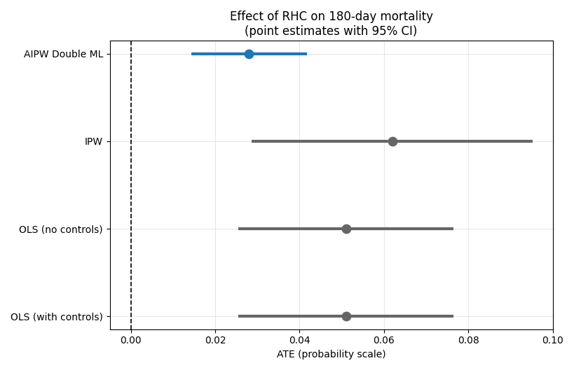
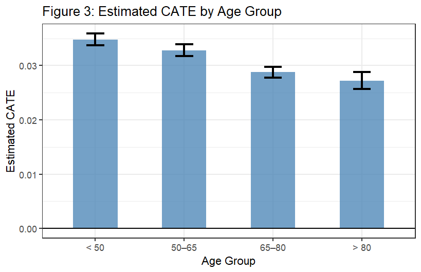
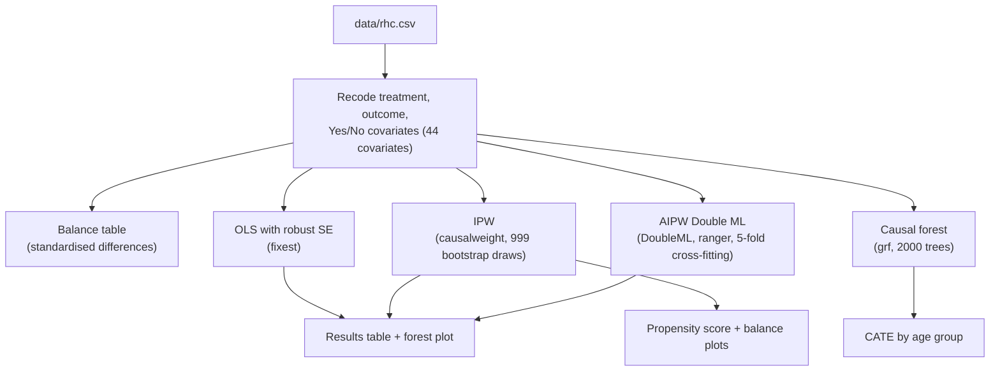

<p align="center">
  
</p>

<p align="center">
  
  
  
  
</p>

Observational causal analysis of the effect of right heart catheterization (RHC) on 180-day mortality in 5,735 critically ill patients from the SUPPORT study. Because treatment was chosen by physicians rather than randomised, the analysis relies on the conditional independence assumption and compares OLS, inverse probability weighting (IPW), doubly robust AIPW with double machine learning, and a causal forest for treatment effect heterogeneity by age.

| | |
|---|---|
| **Context** | University of Southern Denmark (SDU), DSK823 Causal Analysis in Business Data Science |
| **Period** | Jun 2026 |
| **Data** | [RHC dataset](https://hbiostat.org/data/repo/rhc.html), 5,735 patients (2,184 treated, 3,551 control), 44 pre-treatment covariates |
| **Tech** | R, tidyverse, fixest, causalweight, DoubleML + mlr3 (ranger), grf |

📖 **[Full methodology, balance table, assumptions and limitations → documentation.md](documentation.md)**

## Results at a glance

<p align="center">
  
  
</p>

Every method finds that RHC is associated with *higher* mortality, but the size of the effect depends on how confounding is handled. The raw difference is +5.1 percentage points, OLS stays at +5.1, IPW gives +6.2, and the doubly robust AIPW estimator (the preferred one) gives +2.8 pp (95% CI 1.3 to 4.2). The causal forest estimates positive effects in all age groups, largest for patients under 50 (+3.5 pp) and smallest for those over 80 (+2.7 pp).

| Method | ATE | 95% CI |
|---|---|---|
| OLS, no controls | +0.051 | [0.026, 0.076] |
| OLS, 44 covariates | +0.051 | [0.025, 0.077] |
| IPW (5% trimming) | +0.062 | [0.028, 0.095] |
| **AIPW Double ML** | **+0.028** | **[0.013, 0.042]** |

## Architecture



## Project structure

```text
rhc-causal-analysis/
├── rhc_causal_analysis.R    # full analysis: data prep, balance, OLS, IPW, AIPW, causal forest
├── documentation.md         # methodology, assumptions, full results and limitations
├── data/
│   └── rhc.csv              # SUPPORT / RHC dataset (hbiostat.org)
├── figures/                 # propensity scores, balance, CATE, effect estimates
├── assets/
│   └── brand-banner.svg
└── README.md
```

## Outputs

- `figures/propensity_score_distribution.png` — estimated propensity scores by treatment group, showing overlap
- `figures/covariate_balance_ipw.png` — standardised differences before and after IPW
- `figures/cate_by_age_group.png` — causal forest CATE by age group
- `figures/effect_estimates.png` — comparison of all ATE estimates (redrawn from the final reported numbers)

The script prints the balance table, regression tables, ATE estimates and CATE table to the console and draws the plots in the R graphics window.

## Running it

```r
install.packages(c(
  "tidyverse", "fixest", "causalweight", "DoubleML", "mlr3",
  "mlr3learners", "ranger", "data.table", "grf"
))
```

Then open the project folder in RStudio (or set it as the working directory) and run:

```r
source("rhc_causal_analysis.R")
```

The data path is relative to the project folder. The IPW step uses 999 bootstrap draws and the causal forest 2,000 trees, so a full run takes a few minutes. Seeds are set (`42`), but small differences in the bootstrap and cross-fitted estimates between runs and package versions are normal.

## Methodology

Treatment is `swang1` (RHC vs. no RHC) and the outcome is death within 180 days. All 44 covariates are measured before treatment, and `dth30` is deliberately not used as a covariate because it is a post-treatment outcome. Identification rests on the conditional independence assumption, which cannot be tested: unobserved factors such as physician judgement or frailty could still drive both treatment and mortality. IPW uses propensity scores from a logistic regression with 5% trimming, and the AIPW estimator uses random forests for the nuisance functions with 5-fold cross-fitting. The reported CATE confidence intervals come from the spread of the forest's predictions within each age group, so they are narrow and should be read as descriptive, not as formal inference on heterogeneity.

## What I learned

- Adjusting for covariates with a linear model can leave the estimate almost unchanged (+5.1 pp) while a flexible doubly robust estimator moves it substantially (+2.8 pp), so the choice of estimator matters as much as the choice of covariates.
- A causal estimate is only as credible as its identifying assumption: the CIA is untestable, which is why balance and overlap checks come before any effect estimate.
- Group-wise CATE averages from a causal forest say little about uncertainty on their own; proper inference needs the forest's own variance estimates.
