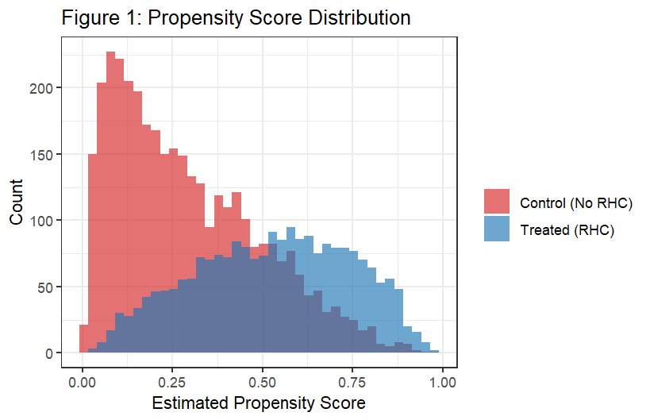
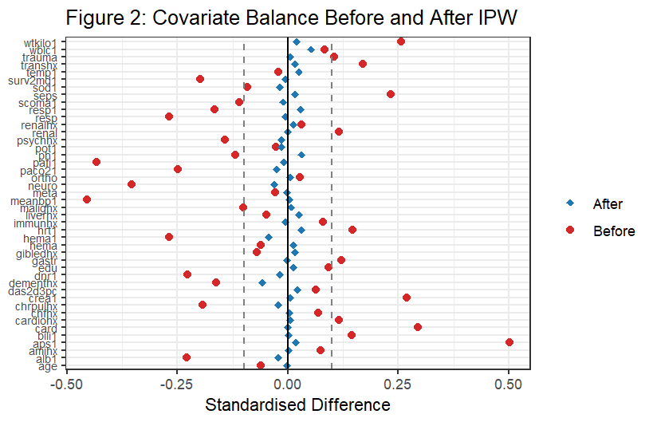

# Documentation: Causal effect of right heart catheterization on mortality

This document contains the full methodology, assumptions and results of the analysis. The [README](README.md) gives the short version, and everything here is produced by `rhc_causal_analysis.R`.

## Contents

1. [Data and setting](#1-data-and-setting)
2. [Identification: the conditional independence assumption](#2-identification-the-conditional-independence-assumption)
3. [Covariate balance before adjustment](#3-covariate-balance-before-adjustment)
4. [Linear regression](#4-linear-regression)
5. [Inverse probability weighting](#5-inverse-probability-weighting)
6. [AIPW with double machine learning](#6-aipw-with-double-machine-learning)
7. [Heterogeneity: causal forest and CATEs](#7-heterogeneity-causal-forest-and-cates)
8. [Summary of results](#8-summary-of-results)
9. [Limitations](#9-limitations)
10. [Implementation notes](#10-implementation-notes)

## 1. Data and setting

The Right Heart Catheterization (RHC) dataset comes from the SUPPORT study. It contains 5,735 critically ill adults admitted to intensive care units at five US teaching hospitals. Source and variable descriptions: [hbiostat.org/data/repo/rhc.html](https://hbiostat.org/data/repo/rhc.html).

| Item | Definition |
|---|---|
| Treatment | `swang1`: whether the patient received a Swan-Ganz catheter (RHC) on the first qualifying day |
| Outcome | `death`: death within 180 days of hospital admission (binary) |
| Covariates | 44 pre-treatment variables: 21 continuous (age, education, APACHE score, vital signs, laboratory values, weight, ...) and 23 binary (comorbidity history, admission diagnoses, do-not-resuscitate status) |

2,184 patients received RHC and 3,551 did not. The raw 180-day mortality is 68.0% in the treated group and 63.0% in the control group, a difference of 5.1 percentage points (pp).

Treatment was decided by physicians, not randomly assigned, so this is an observational study. There is no panel structure, no instrument and no treatment threshold that would allow a regression discontinuity design. The analysis therefore relies on the conditional independence assumption.

## 2. Identification: the conditional independence assumption

The conditional independence assumption (CIA) states that, given the observed pre-treatment covariates X, the potential outcomes are independent of treatment assignment:

```text
Y(0), Y(1)  ⊥  D | X
```

The dataset describes illness severity, laboratory values, vital signs, diagnoses and comorbidities, which probably capture many of the factors physicians considered when deciding on a catheter. The CIA cannot be tested, though. Physician judgement, hospital culture or hard-to-measure aspects of severity could still influence both treatment and mortality, so every causal statement below holds only if the observed covariates adequately account for the main sources of confounding.

Variables measured after treatment are not used as covariates. This includes `dth30` (death within 30 days), which is an outcome.

## 3. Covariate balance before adjustment

Standardised difference = difference in group means divided by the pooled standard deviation. Absolute values above 0.1 indicate meaningful imbalance. The table shows the continuous covariates that are discussed in the analysis.

| Variable | Control mean | Treated mean | Std. diff. | p-value |
|---|---|---|---|---|
| Age (years) | 61.76 | 60.75 | -0.061 | 0.026 |
| Education (years) | 11.57 | 11.86 | +0.091 | 0.001 |
| Survival probability (2 months) | 0.607 | 0.568 | -0.198 | <0.001 |
| APACHE score | 50.93 | 60.74 | +0.501 | <0.001 |
| Glasgow Coma Score | 22.25 | 18.97 | -0.110 | <0.001 |
| Mean blood pressure | 84.87 | 68.20 | -0.455 | <0.001 |
| Heart rate | 112.9 | 118.9 | +0.147 | <0.001 |
| Respiratory rate | 28.98 | 26.65 | -0.165 | <0.001 |
| PaO₂/FiO₂ ratio | 240.6 | 192.4 | -0.433 | <0.001 |
| Albumin | 3.164 | 2.978 | -0.230 | <0.001 |
| Haematocrit | 32.70 | 30.51 | -0.269 | <0.001 |
| Creatinine | 1.924 | 2.473 | +0.270 | <0.001 |
| PaCO₂ | 39.95 | 36.79 | -0.249 | <0.001 |
| Weight (kg) | 65.04 | 72.36 | +0.256 | <0.001 |
| pH | 7.393 | 7.380 | -0.120 | <0.001 |

Treated patients are substantially sicker: the APACHE score is about half a standard deviation higher, blood pressure is lower, oxygenation is worse, and albumin and haematocrit are reduced. This is confounding by indication. The sicker a patient is, the more likely a physician is to insert a catheter, yet the same patients have a higher baseline mortality regardless of catheterisation.

## 4. Linear regression

Two OLS models with heteroskedasticity-robust (HC3) standard errors, estimated with `fixest`:

```text
died = β0 + β1 · treat + ε                 (no controls)
died = β0 + β1 · treat + X'γ + ε           (44 covariates)
```

| Model | β1 | Robust SE | 95% CI |
|---|---|---|---|
| No controls | 0.051 | 0.013 | [0.026, 0.076] |
| With controls (N = 5,735) | 0.051 | 0.013 | [0.025, 0.077] |

The unadjusted estimate mixes the effect of RHC with the fact that treated patients are sicker. The estimate hardly changes after adding covariates. That does not mean that confounding is absent, only that this linear specification is stable. A linear model may not capture non-linear relationships between severity and treatment.

## 5. Inverse probability weighting

IPW weights each observation by the inverse of the probability of receiving the treatment it actually received, which creates a pseudo-population in which treatment is unrelated to the covariates:

```text
w_i = D_i / p(X_i) + (1 - D_i) / (1 - p(X_i))
```

The propensity score p(X) is estimated by logistic regression on all 44 covariates. The effect is computed with `causalweight::treatweight`, with propensity scores trimmed at 0.05 to limit the influence of extreme weights, and standard errors from 999 bootstrap draws.

**Result:** ATE = +0.062 (bootstrap SE 0.017, 95% CI [0.028, 0.095]).

<p align="center">
  
  
</p>

The propensity score histograms overlap over most of the range, so comparable treated and control patients exist for most covariate profiles. Few control patients have very high scores, which is why trimming is used. The second plot compares standardised differences before and after weighting. The dashed lines mark ±0.1.

## 6. AIPW with double machine learning

The augmented IPW (AIPW) estimator combines an outcome model with a propensity model. The effect for each observation is

```text
ψ_i = μ(1, X_i) - μ(0, X_i) + D_i (Y_i - μ(1, X_i)) / p(X_i) - (1 - D_i)(Y_i - μ(0, X_i)) / (1 - p(X_i))
```

and the ATE is the mean of ψ_i. It is doubly robust: the estimate stays consistent if either the outcome model or the propensity model is correctly specified. The Neyman-orthogonal score and cross-fitting also make it robust to small errors in the nuisance functions when these are estimated flexibly.

The implementation uses `DoubleML::DoubleMLIRM` with the ATE score, random forests (`ranger`, 500 trees) for both the outcome and the propensity model, and 5-fold cross-fitting.

**Result:** ATE = +0.028 (SE 0.007, 95% CI [0.013, 0.042]).

AIPW is the preferred estimator because it makes the fewest parametric assumptions and is doubly robust. It is still based on the CIA and on overlap, as the other methods are.

## 7. Heterogeneity: causal forest and CATEs

A causal forest (`grf::causal_forest`, 2,000 trees, honest estimation) estimates individual treatment effects. The predictions are averaged within four age groups:

| Age group | CATE | SE | 95% CI | n |
|---|---|---|---|---|
| < 50 | +0.035 | 0.001 | [0.034, 0.036] | 1,424 |
| 50–65 | +0.033 | 0.001 | [0.032, 0.034] | 1,574 |
| 65–80 | +0.029 | 0.000 | [0.028, 0.030] | 2,070 |
| > 80 | +0.027 | 0.001 | [0.026, 0.029] | 667 |

<p align="center">
  
</p>

All age groups show positive estimated effects, largest for patients under 50 and declining with age. One reading is that the overall effect is driven somewhat more by younger, less critically ill patients, for whom the monitoring benefit of RHC is less clear.

**How to read the intervals:** the SE in this table is the standard deviation of the individual CATE predictions divided by √n in each group. It therefore describes the spread of the predictions, not the sampling uncertainty of the forest, and the intervals are much narrower than a proper confidence interval would be. The age gradient is a descriptive pattern, not a formal test of heterogeneity. For formal inference, `grf::average_treatment_effect(cf, subset = ...)` or `grf::test_calibration()` can be used.

## 8. Summary of results

| Method | ATE | SE | 95% CI |
|---|---|---|---|
| OLS (no controls) | +0.051 | 0.013 | [0.026, 0.076] |
| OLS (with controls) | +0.051 | 0.013 | [0.025, 0.077] |
| IPW | +0.062 | 0.017 | [0.028, 0.095] |
| **AIPW Double ML** | **+0.028** | **0.007** | **[0.013, 0.042]** |

<p align="center">
  
</p>

All methods give a positive effect, meaning higher 180-day mortality for RHC patients. Under the CIA, the preferred AIPW estimate is that RHC increases mortality by about 2.8 percentage points (95% CI 1.3 to 4.2).

The gap between OLS/IPW (+5 to +6 pp) and AIPW (+2.8 pp) is the most informative result. A plausible explanation is that the linear regression and the logistic propensity model do not fully capture non-linear interactions between severity indicators and the likelihood of receiving RHC, which the random forests can model. This is an interpretation, not something the analysis tests, and some of the gap may also come from modelling choices and estimation uncertainty.

## 9. Limitations

- **Unobserved confounding.** The CIA is untestable. Physician judgement, hospital culture or unmeasured severity could bias all estimates.
- **External validity.** The data come from critically ill patients in US teaching hospitals in the 1990s, and practice has changed since.
- **Sensitivity to modelling.** The estimates range from +2.8 to +6.2 pp depending on the method.
- **Overlap.** IPW weights get large where the propensity score is close to 0 or 1, which is why scores are trimmed at 0.05.
- **CATE inference.** The reported intervals reflect prediction spread only (see section 7).
- **Single run.** Bootstrap and cross-fitting results vary slightly between runs and package versions, even with `set.seed(42)`.

Overall, the evidence suggests that RHC is unlikely to improve survival and may increase mortality, but conclusions drawn from observational data should be read with caution.

## 10. Implementation notes

| Step | Code (`rhc_causal_analysis.R`) | Package |
|---|---|---|
| Recode treatment, outcome and Yes/No variables | top of script | base R, tidyverse |
| Complete cases on continuous covariates | `complete.cases(df[, covs_cont])` (no rows dropped, N = 5,735) | base R |
| Balance table | `balance_table` | tidyverse |
| OLS | `feols(..., vcov = "HC3")` | fixest |
| IPW | `treatweight(..., trim = 0.05, boot = 999)` | causalweight |
| Propensity score and balance plots | `glm(..., family = binomial)`, `ipw_weight` | base R, ggplot2 |
| AIPW | `DoubleMLIRM$new(..., n_folds = 5, score = "ATE")` | DoubleML, mlr3, ranger |
| Causal forest | `causal_forest(..., num.trees = 2000)` | grf |

The propensity score plot and the balance plot use an untrimmed logistic propensity score, so the weights in the balance check differ slightly from the trimmed IPW estimate.
